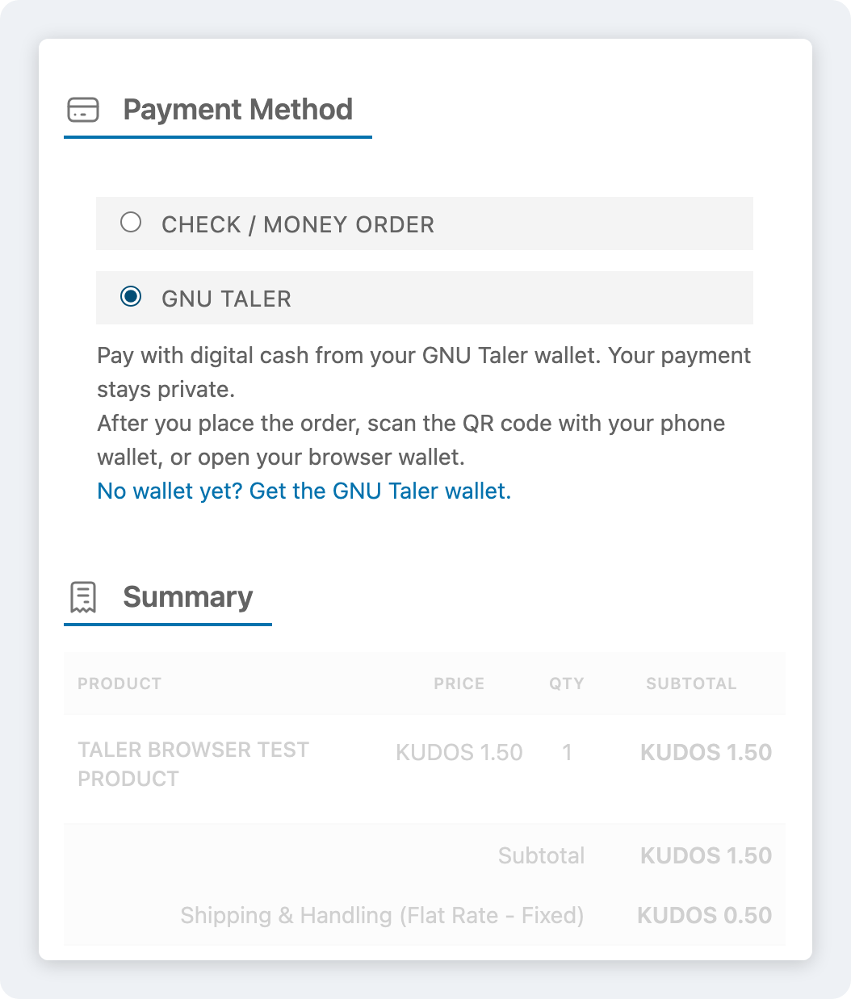
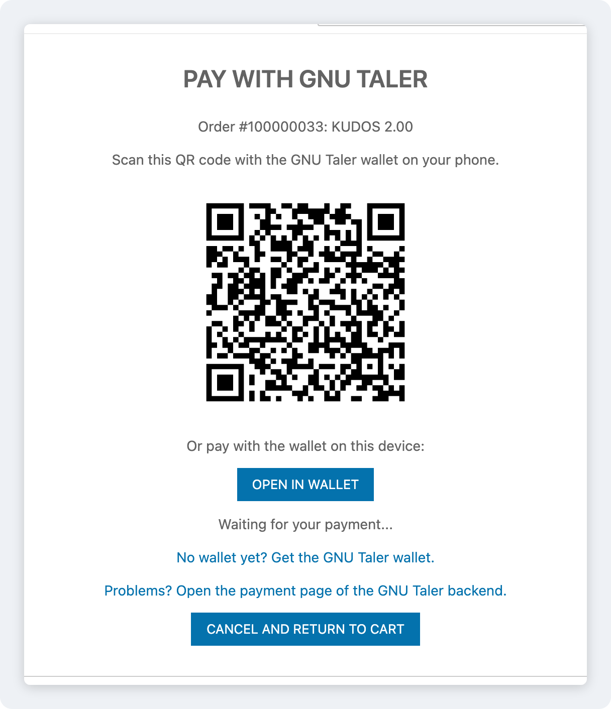
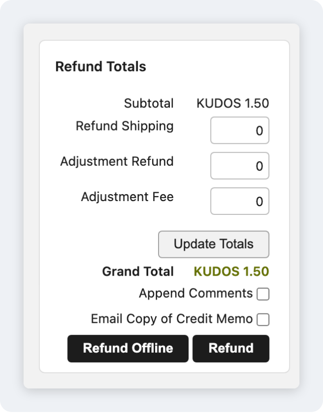
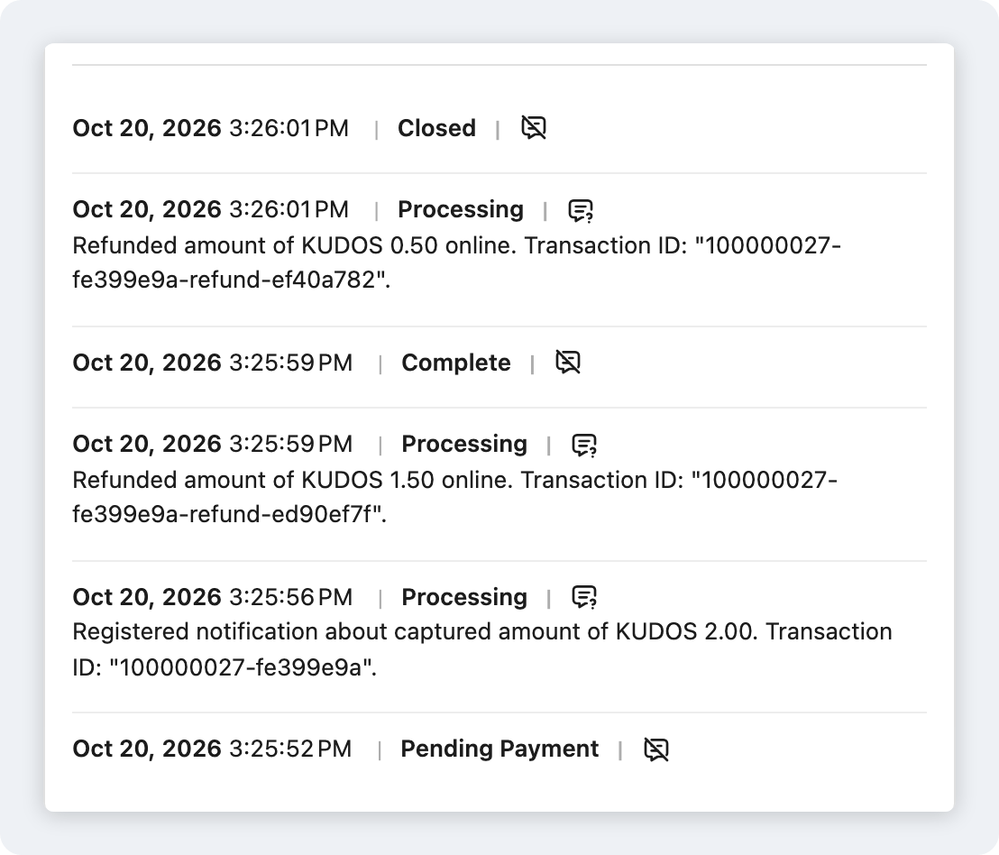

# GNU Taler payment gateway integration for Maho Commerce


Accept payments through [GNU Taler](https://www.taler.net), the free and open source, privacy-preserving payment system. Shoppers pay from a Taler wallet (browser extension or mobile app) using digital cash — the payer stays anonymous while every transaction remains taxable and auditable on the merchant side.

## How GNU Taler works

Unlike card gateways, Taler does not process cards or hold merchant funds. You run (or connect to) a **Taler merchant backend** that talks to an exchange. Maho creates an order in the backend, the customer's wallet claims and pays it, and Maho confirms the payment by polling the backend. Settlement to your bank account is handled by the exchange out of band.

## Requirements

- PHP >= 8.5
- Maho Commerce >= 26.9
- Access to a [GNU Taler merchant backend](https://docs.taler.net/taler-merchant-manual.html) instance and the API access token for one of its instances

## Installation

```bash
composer require mahocommerce/module-taler
```

Clear the cache after installation:

```bash
./maho cache:flush
```

## Configuration

Navigate to **System > Configuration > Payment Methods > Taler** in the Maho admin panel.

| Setting | Description | Default |
|---|---|---|
| **Enabled** | Activate the payment method | No |
| **Title** | Payment method name shown at checkout | GNU Taler |
| **Merchant Backend URL** | Base URL of your Taler merchant backend (e.g. `https://backend.demo.taler.net/`) | — |
| **Instance** | Merchant backend instance ID to bill against | — |
| **API Access Token** | Bearer token used to authenticate against the backend (`Authorization: Bearer secret-token:...`) | — |
| **Accepted Currency** | Currency the backend accepts (e.g. `EUR`). Checkout hides GNU Taler when the cart currency is different. Leave empty and save to read it from the backend | — |
| **Refund Window (days)** | Refund window granted at order creation; after it passes the backend rejects refunds | 14 |
| **Payment Notifications (Webhook)** | Register a `pay` webhook in the backend when you save (see [Webhook](#webhook)) | Yes |
| **Debug Logging** | Log API requests and responses to `var/log/taler.log` | No |
| **Payment Page** | **Store page**: the store shows the QR code and the wallet link and polls for the payment. **Taler backend page**: the customer pays on the page of the merchant backend | Store page |
| **Applicable Countries** | All countries or specific countries only | All |
| **Minimum / Maximum Order Total** | Hide GNU Taler outside this range of the base grand total. Empty means no limit | — |
| **Sort Order** | Display position among payment methods | 100 |
| **Pending / Paid order statuses** | Order statuses applied while awaiting payment and after confirmation | pending_payment / processing |

The connection settings are website-scoped, so different websites can bill against different backends or instances.

When you save the payment configuration, the module checks the connection with the backend `/config` endpoint. It fills in **Accepted Currency** when it is empty, warns when the backend does not support it, and registers the webhook.

### Webhook

With **Payment Notifications** on, saving the configuration creates (or updates) a `pay` webhook in the merchant backend. It points to `<store URL>/taler/webhook/` and sends a random shared secret, which the module stores encrypted, in the `X-Maho-Taler-Secret` header. The webhook ID is derived from the store URL, so several stores can share one backend instance. The backend must be able to reach the store. Without the webhook, the payment page polling, the return URL and the cron job still finalize every order.

### Sandbox / demo

GNU Taler runs a public demo environment you can use for testing without real money:

- Merchant backend: <https://backend.demo.taler.net/>
- Demo bank (to fund a wallet with `KUDOS`): <https://bank.demo.taler.net/>
- Install the [Taler wallet](https://wallet.taler.net/) browser extension or mobile app to pay

Amounts are expressed in Taler's `CURRENCY:VALUE.FRACTION` format (e.g. `EUR:10.00`, `KUDOS:5.00`).

## How It Works

1. **Order placement**: the customer selects GNU Taler at checkout; the module calls `POST /private/orders` on the merchant backend, which returns an `order_id` (plus a claim token).
2. **Payment**: by default the store shows its own payment page with the QR code and a `taler://pay/` link for browser and desktop wallets. The page polls the store, which long-polls the backend and opens the success page when the payment arrives. With the **Taler backend page** setting, the customer pays on the backend-hosted page (`order_status_url`) instead, which redirects back to the store once paid. **Cancel and return to cart** deletes the unpaid order in the backend, so the wallet cannot pay it later, and restores the cart.
3. **Confirmation**: the payment status always comes from `GET /private/orders/{order_id}`, never from the browser or the webhook body. The webhook, the payment page, the return URL and a 5-minute cron job can all trigger this check. A per-order lock makes sure that a payment is captured and invoiced only once. The cron job also cancels orders that stay unpaid for 4 hours.
4. **Refunds**: full and partial refunds are issued from the Maho admin (online creditmemos) via `POST /private/orders/{order_id}/refund`.

The module talks to the backend through its own small REST client (`Maho_Taler_Model_Api`), because there is no official PHP SDK for GNU Taler.

## Screenshots

<table>
  <tr>
    <td width="50%" valign="top" align="center">
      <br>
      <sub><b>1. Checkout.</b> The customer selects GNU Taler.</sub>
    </td>
    <td width="50%" valign="top" align="center">
      <br>
      <sub><b>2. Payment.</b> The store payment page. Scan the QR code with a phone wallet, or open the wallet on this device.</sub>
    </td>
  </tr>
  <tr>
    <td width="50%" valign="top" align="center">
      <br>
      <sub><b>3. Refund.</b> Open the invoice, click <b>Credit Memo</b>, then <b>Refund</b>. The order's <b>Credit Memo</b> button makes offline refunds only.</sub>
    </td>
    <td width="50%" valign="top" align="center">
      <br>
      <sub><b>4. History.</b> The capture, a partial refund and a second refund for the rest.</sub>
    </td>
  </tr>
</table>

<sub>The <a href="#browser-tests">browser tests</a> take these screenshots against the public demo backend.</sub>

## Development

This module ships with the standard Maho CI gates:

- **Pest** (unit tests) — `vendor/bin/pest --testsuite Unit`
- **PHPStan** (level 8) — `vendor/bin/phpstan analyze`
- **Rector** (dry-run) — `vendor/bin/rector --dry-run`
- **PHP CS Fixer** (dry-run) — `vendor/bin/php-cs-fixer fix --dry-run`
- **PHP / XML syntax checks** — automatic on CI

Run `composer install` and you can execute any of the above locally before pushing.

### Integration tests

The integration suite boots a real Maho application and exercises the API client against a live Taler merchant backend (order create/read/delete, refund, webhook create/update/delete, and auth error mapping), plus the webhook handler and the payment status check against real backend orders. On CI it runs against the public demo backend by default; set the `TALER_BACKEND_URL`, `TALER_INSTANCE` and `TALER_API_TOKEN` repository secrets to test against your own backend instead (use `@root` as the instance for the default instance at the backend root).

When `taler-wallet-cli` is available (on Linux: Taler's `noble-testing` apt channel, matching the demo deployment), the suite also runs **real payments**: a headless wallet withdraws KUDOS from the demo bank, pays the order, and the tests verify the paid status, cumulative partial refunds, the wallet collecting the refund, and that repeated webhook calls capture a paid order only once. These paid-path tests skip automatically when the wallet CLI is missing or the backend currency is not KUDOS.

To run it locally, install Maho into this repo once (SQLite, no services needed) and opt in via the environment:

```bash
composer install
php maho install --license_agreement_accepted yes \
  --locale en_US --timezone Europe/Rome --default_currency EUR \
  --db_engine sqlite --db_name taler_test.sqlite \
  --db_host localhost --db_user '' --db_pass '' \
  --url 'http://taler.test/' \
  --admin_lastname Test --admin_firstname Test \
  --admin_email test@example.com \
  --admin_username admin --admin_password 'AdminTest123456!'

TALER_INTEGRATION=1 vendor/bin/pest --testsuite Integration
```

These tests call the API client directly. The [browser tests](#browser-tests) cover the storefront and admin side.

### Browser tests

A [Playwright](https://playwright.dev) suite in `tests/Browser` runs the whole flow in Chromium against the demo backend:

1. A guest buys a product and picks GNU Taler at checkout.
2. The browser lands on the store payment page. `taler-wallet-cli` pays the `taler://pay` URI shown there, as a phone wallet scanning the QR code would.
3. The page polling sends the browser to the success page. The test checks the success page, the invoice and the order state.
4. An admin opens the invoice and creates an online credit memo. The test checks the refund in the backend.
5. A second guest checkout repeats steps 1 to 3 with the **Taler backend page** setting.

The Node tooling stays in `tests/Browser`, and `.gitattributes` strips `tests/` from Composer downloads, so the module itself has no Node dependency.

To run it locally, install Maho as for the integration tests (the base URL is replaced by the setup script), then:

```bash
php tests/Browser/setup.php
cd tests/Browser
npm ci
npx playwright install chromium
npx playwright test
```

To update the screenshots in this README, run the tests with `TALER_SCREENSHOTS_DIR=../../.github/screenshots npx playwright test` and commit the new images.

`setup.php` switches the store currency to the backend currency (KUDOS) and creates a test product, so use a disposable installation. The test starts `php maho serve` on port 8000 unless a server already runs there. Set `TALER_WALLET_CLI` when the wallet binary is not on the `PATH` (for example a Docker wrapper on macOS).

The browser tests do not cover the Taler browser extension or mobile wallets. Test a payment by hand with a real wallet before going live (see [Sandbox / demo](#sandbox--demo)).

## License

This module is licensed under the [Open Software License v3.0](LICENSE.txt).

## Links

- [Maho Commerce](https://mahocommerce.com)
- [GNU Taler](https://www.taler.net)
- [GNU Taler documentation](https://docs.taler.net/)
- [GNU Taler merchant backend API](https://docs.taler.net/core/api-merchant.html)
